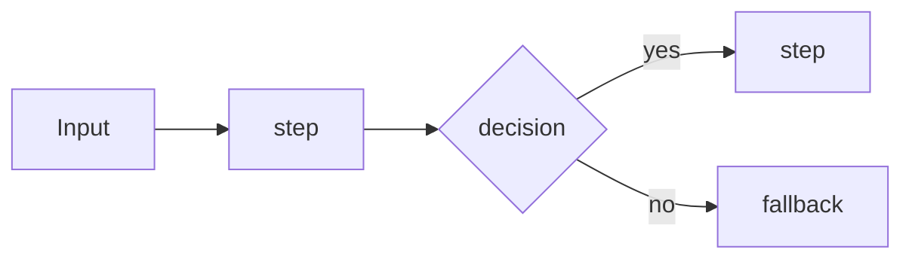

# Document a feature (docs-as-code)

Goal: anyone can open a module folder and understand in 2 minutes what it does, how data flows through it, and why it was built that way. Docs ship in the **same PR** as the code; a PR that changes behaviour without updating its README is not done.

## The three layers

| Layer | File | Write when |
|---|---|---|
| System map | `docs/architecture.md` | A phase adds or changes a part (new service, table group, external API) |
| Module README | `lib/<module>/README.md` (and `app/<route>/README.md` for big routes) | **Every** feature PR that touches the module |
| Decision record (ADR) | `docs/adr/NNNN-short-title.md` | Only for significant decisions: structure, dependencies, interfaces, data model, security, or a choice between real alternatives |

## Step 1: Find what changed
Read the diff and the approved design from `/design-feature`. List the touched modules, new or changed exports, tables, env vars, and external calls.

## Step 2: Write or update the module README
Use this template. Keep it to about one screen. Write the *why* and the flow, never a line-by-line restatement of the code.

````markdown
# <module name>

<One sentence: what this module does and for whom.>

## Flow

<2–4 lines on the happy path and the main failure path.>

## Public API
| Export | Input → Output | Notes |
|---|---|---|
| `functionName()` | `Type` → `Type` | Zod schema: `SchemaName` |

## Data
| Table | Reads / writes | Notes (RLS, indexes, idempotency) |
|---|---|---|

## Depends on / used by
- Depends on: <modules, external APIs, env vars>
- Used by: <modules / routes>

## Errors and limits
| Case | Behaviour | Logged as |
|---|---|---|

## Cost
<Per-request cost and where it is logged (llm_calls).>

## Tests
- Unit: `path`
- Integration: `path`
- Evals: `evals/...` (if AI output is involved)

## Decisions
- [ADR-NNNN: title](../../docs/adr/NNNN-title.md)
````

Rules:
- The flow diagram is **required**. Use a Mermaid `flowchart` for pipelines and a `sequenceDiagram` when several services talk (webhooks, payments, WhatsApp). It renders natively on GitHub.
- Every export in the Public API table matches a real export. Remove rows for deleted code.
- TSDoc only on exported functions, and only for the *why*, contracts and gotchas. No comments that repeat the code.

## Step 3: Update `docs/architecture.md` (when the system shape changed)
- C4 level 1 (context: visitor, admin, Passline, external services) and level 2 (containers: Next.js app, Supabase Postgres, Voyage, model providers, Stripe…) as Mermaid diagrams.
- One line per module linking to its README.
- Never duplicate module detail here; link to it.

## Step 4: Write an ADR (only for significant decisions)
File `docs/adr/NNNN-short-title.md`, numbered in order, never renumbered. Nygard format, plus "Alternatives":

```markdown
# NNNN. <Decision title>
Date: YYYY-MM-DD · Status: Accepted | Superseded by NNNN

## Context
<The forces and constraints, in a few lines.>

## Decision
<What we chose, in one or two sentences.>

## Alternatives considered
- <Option>: <why not>

## Consequences
<What gets easier, what gets harder, follow-up work.>
```

A changed decision gets a **new** ADR that supersedes the old one. Old ADRs are never edited, except to update their status line.

## Step 5: Check before the PR
- [ ] The module README exists, and its flow diagram matches the code
- [ ] The Public API table matches the real exports
- [ ] Tables, RLS, env vars and costs are listed
- [ ] `docs/architecture.md` is updated if the system shape changed
- [ ] An ADR was added for each significant decision, and linked from the README
- [ ] No secrets, real customer data, real business names, or names other than Passline / Thymewick / Saltquay in any doc

Report to Amir what was documented, in a short table.
