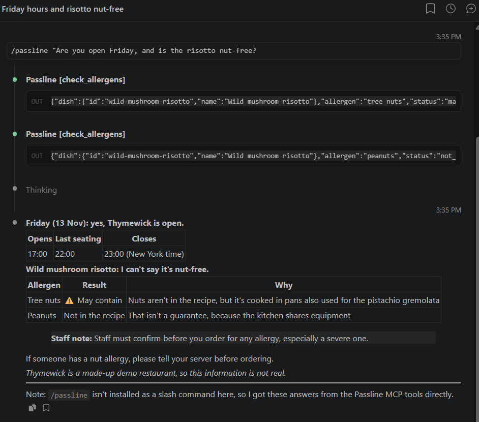

# Passline

**AI front desk for restaurants (portfolio demo).** · Live: **https://passline-delta.vercel.app**

Passline answers guest questions from a restaurant's own documents, shows the exact passage it used, refuses to guess, and hands allergy questions to staff. Each release adds one more working piece of the front desk, all of it real and testable.

> **Status:** Phase 0 (MCP server) is out: [`passline-mcp` on npm](https://www.npmjs.com/package/passline-mcp). Phase 1 (knowledge desk) is next.
> **All data is fictional.** The demo restaurant, Thymewick, does not exist.

## Try the MCP server

Five read-only tools for the fictional restaurant Thymewick: opening hours, table availability, menu search, allergen checks and a floor-plan image.

```bash
claude mcp add passline -- npx -y passline-mcp
```

Setup for Claude Desktop, Cursor and MCP Inspector, how the tool descriptions are written, and how the image is returned: [packages/mcp-server/README.md](packages/mcp-server/README.md).



## What it proves

| Skill | How Passline proves it |
|---|---|
| MCP servers | Public MCP tools (hours, menu, allergens, availability, floor-plan image), tested in MCP Inspector, Claude Desktop, Claude Code and Cursor |
| RAG / document Q&A | Answers from restaurant documents with page-level citations, hybrid search, reranking and evals |
| Two-way messaging agents | WhatsApp guest conversations in English and Arabic, with staff handoff |
| Payments / accounting | Stripe test deposits, verified webhooks, idempotency, reconciliation, QuickBooks sandbox |
| AI evaluation and cost control | Evaluation suite, per-answer cost and trace inspector, a $1/day spend cap |
| Workflow automation | Guest win-back campaign with a dry run, plus an n8n workflow |
| Calendar / CRM integrations | Live availability, conflict checks, HubSpot deal sync |

## Roadmap

| Phase | Feature |
|---|---|
| 0 | MCP server: read-only restaurant tools over structured fictional data |
| 1 | Knowledge desk: RAG with citations, refusals, allergy handoff, model switcher, evals |
| 2 | Bookings: availability, create / reschedule / cancel, conflict rejection |
| 3 | Conversations and an embeddable website widget |
| 4 | WhatsApp, English and Arabic, opt-out first, staff handoff |
| 5 | Stripe test deposits, webhooks, reconciliation, QuickBooks sandbox |
| 6 | Remote MCP server with auth and booking tools, plus an AI Inspector |
| 7 | Campaign dry run, n8n workflow, HubSpot sync, safe background jobs |
| 8 | Second fictional restaurant (Saltquay) and team roles |

## Stack

TypeScript, Next.js, Tailwind CSS + shadcn/ui, Supabase Postgres + pgvector, Voyage AI, Zod, Vitest and Vercel. The MCP server uses the official MCP TypeScript SDK. The answer models can be switched between free models (Gemini, Llama on Groq) and Claude Haiku.

## Docs

- [Project brief](docs/PROJECT-BRIEF.md): what is built, in what order, and the rules
- [Product](PRODUCT.md): users, purpose, limits and decisions
- [Design system](DESIGN.md): colours, type, layout and components

## License

[MIT](LICENSE) © 2026 Amir Gad
