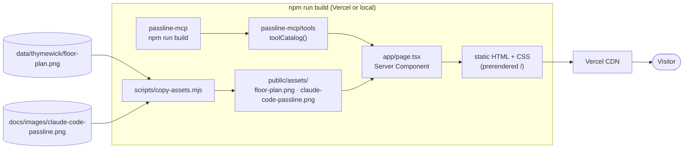

# passline-web

The public Passline page: what Passline is, the MCP server (tools, install, proof, how the image is returned) and the roadmap. It's fully **static**: no API, database, keys or AI calls, so hosting costs nothing and there's nothing to abuse.

> All data is fictional. Thymewick is not a real restaurant.

## Flow



- **Tool cards come from the server's code.** `passline-mcp/tools` exports `toolCatalog()`, the same list the server registers. `lib/tool-cards.ts` turns it into cards using the first line and the "Use when" line of each model-facing description. When a tool changes, the page changes on the next build; it can't drift.
- **Images keep one source.** The floor plan lives in `data/thymewick/`, the screenshot in `docs/images/`. They're copied into `public/assets/` at build time; that folder is gitignored.
- The only client-side code is the Copy button (`components/copy-command.tsx`). If the clipboard is blocked, it selects the text and says "Press Ctrl+C".

## Run

```bash
npm install               # at the repo root
npm run dev -w passline-web
npm run build -w passline-web && npm run start -w passline-web
```

`predev` / `prebuild` build `passline-mcp` and copy the images first.

## Stack

Live at https://passline-delta.vercel.app (Vercel, Root Directory `apps/web`).

Next.js 16 (App Router, static), React 19, Tailwind CSS v4 with the `DESIGN.md` tokens as CSS variables (`app/globals.css`, light and dark), Geist fonts. All versions are pinned.

No shadcn components yet: the page needs one button, and a component library for that would be an abstraction used once. shadcn comes in with the Phase 1 app (Sheet, Popover, Tabs…).

## Deploy (Vercel)

New Project → `Amir1887/passline` → **Root Directory `apps/web`** → Framework **Next.js** → Deploy. Vercel installs at the monorepo root (npm workspaces) and runs `npm run build` in `apps/web`. No environment variables are needed. Every PR then gets a preview URL.

## Tests

- `test/tool-cards.test.ts`: the page shows exactly the 5 tools the server registers, with a summary and a "Use when" line each, and the right kit labels
- CI runs `typecheck` (with `next typegen`) and `next build` on Node 20, 22 and 24

## Errors and limits

| Case | Behaviour |
|---|---|
| A tool is added, renamed or reworded | The next build shows it; the test catches a missing summary or "Use when" line |
| Clipboard blocked (some browsers or iframes) | The command is selected and the button says "Press Ctrl+C" |
| An image file is missing | `copy-assets` fails the build loudly instead of shipping a broken image |

## Decisions

- [ADR 0005: The public page reads its tool list from the server package](../../docs/adr/0005-public-page-reads-tool-catalog.md)
