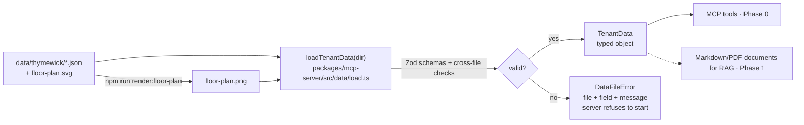

# Tenant data

Fictional source data for each demo business, one folder per tenant. This is the **single source of truth**: the MCP server reads it today (Phase 0), and the RAG documents (Phase 1) will be generated from it, so both always give the same answer.

> All data is fictional. Thymewick is not a real restaurant.

## Flow

The loader validates everything at startup. A broken file stops the server with a message such as `hours.json: weekly.friday.open: Expected 24-hour time HH:MM`, so the problem never surfaces as a wrong answer inside a tool call.

## Files (per tenant)

| File | Kind | Holds | Key rules |
|---|---|---|---|
| `restaurant.json` | core | id, name, `vertical`, IANA time zone, currency, max party size, sandbox notice | `vertical` picks the kit; max party size ≤ largest table |
| `hours.json` | core | weekly hours (`null` = closed), last seating, notes, dated closures | `HH:MM` 24-hour; open < close; open ≤ last seating ≤ close; one closure per date |
| `availability.json` | core | slot length, seating length, booking window (days), tables (seats, area, `staff_only`), recurring bookings | unique table ids; bookings point to real tables and fall on a slot |
| `menu.json` | restaurant kit | tracked allergens (subset of 14 standard codes), dishes (course, USD price, vegetarian/vegan, `contains`, `may_contain` + reason) | dish allergens must be tracked; vegan ⇒ vegetarian; `may_contain` needs a reason; no allergen in both lists |
| `floor-plan.svg` | core | the dining-room layout | every table id from `availability.json` is drawn once |
| `floor-plan.png` | core (generated) | 1280×800 PNG returned by the MCP image tool | rendered from the SVG; committed so users need no native renderer |

"Core" files work for any business. "Kit" files belong to one vertical (see the industry-ready rule in `CLAUDE.md`).

## Editing the data

1. Edit the JSON or the SVG.
2. If you changed the SVG, run `npm run render:floor-plan -w passline-mcp`.
3. Run `npm test`. The data tests load the real files and fail on any broken rule.

## Adding a tenant

Create `data/<tenant-id>/` with the same files, then point the server at it. The second fictional tenant, **Saltquay**, arrives in Phase 8.

## Code

- Schemas: [`packages/mcp-server/src/data/schemas.ts`](../packages/mcp-server/src/data/schemas.ts)
- Loader: [`packages/mcp-server/src/data/load.ts`](../packages/mcp-server/src/data/load.ts)
- Tests: [`packages/mcp-server/test/data/`](../packages/mcp-server/test/data/): 16 cases for the real data and for broken data
- Decision: [ADR 0002](../docs/adr/0002-tenant-data-single-source.md)
