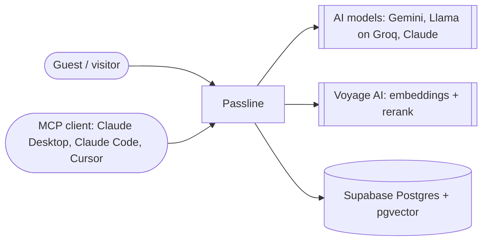
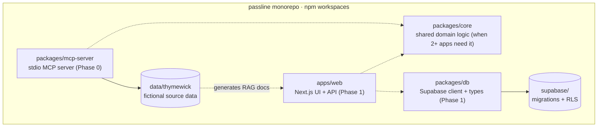

# Passline architecture

The system map. Module detail lives in each module's own README; this page only shows how the parts connect.

## Context (C4 level 1)

Phase 0 uses only the MCP client path. AI models, Voyage and the database arrive in Phase 1.

## Containers (C4 level 2)

Dashed lines are planned and not built yet.

## Modules

| Module | Status | README |
|---|---|---|
| `data/` (tenant data + loader) | Phase 0, done | [`data/README.md`](../data/README.md) |
| `packages/mcp-server` | Phase 0, in progress: 4 of 5 tools (hours, availability, menu, allergens) | [`packages/mcp-server/README.md`](../packages/mcp-server/README.md) |

## Decisions

- [ADR 0001: Monorepo layout with npm workspaces](adr/0001-monorepo-layout.md)
- [ADR 0002: Structured tenant data files as the single source of truth](adr/0002-tenant-data-single-source.md)
- [ADR 0003: MCP SDK v2, stdio first, one server factory](adr/0003-mcp-sdk-v2-stdio-factory.md)
- [ADR 0004: Allergen answers never claim a dish is safe](adr/0004-allergen-answers-never-claim-safety.md)
