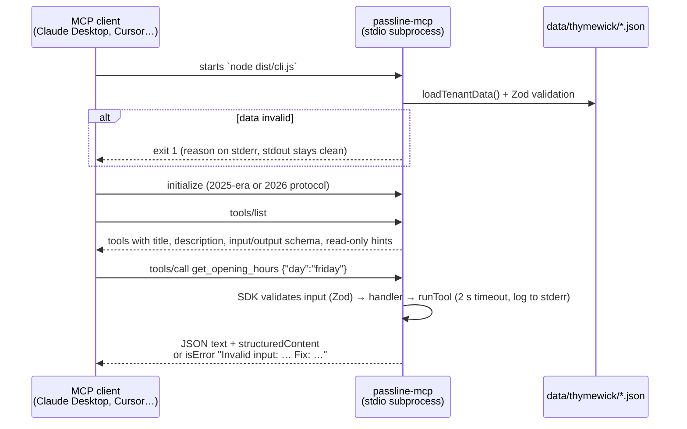

# passline-mcp

An MCP server for **Thymewick**, a fictional demo restaurant. It gives any MCP client (Claude Desktop, Claude Code, Cursor, MCP Inspector) five read-only tools: opening hours, table availability, menu search, allergen checks, and a floor-plan image.

> **All data is fictional.** Thymewick is not a real restaurant. Every tool result says so.
>
> **Status:** Phase 0: all 5 tools built and tested. Next: client configs, screenshots and the npm package.

## Flow



The server is a factory, `createServer({ data, clock, logger })`. stdio uses it through `serveStdio()`; the remote HTTP server in Phase 6 will use the same factory through `createMcpHandler()`.

## Tools

| Tool | Kit | Input | Returns |
|---|---|---|---|
| `get_opening_hours` | core | `day` (lowercase weekday) **or** `date` (YYYY-MM-DD), or neither for today | `open`, `opens`, `closes`, `last_seating`, `note` or `reason`, `today`, `timezone` |
| `check_availability` | core | `date`, `time` (HH:MM on a 30-min slot), `party_size` (1–12) | `available`, `area` or `reason`, up to 4 nearest free `alternatives`. Checks only; never books |
| `search_menu` | restaurant | optional `query`, `course`, `vegetarian`, `vegan`, `max_price` (USD) | `count`, `dishes` (name, course, price, veg flags). **No allergen data**, on purpose |
| `check_allergens` | restaurant | `dish` (name or unique part), `allergen` (one of 14 codes) | `status`: `contains` \| `may_contain` (+ reason) \| `not_listed` \| `not_tracked`, `meaning`, **`staff_note` always** |
| `get_floor_plan` | core | none (`{}`) | A **PNG image** block (1280×800) + a text block with every table, its seats and its area |

Every result also carries `sandbox` (the fictional-data notice). All tools are annotated `readOnlyHint: true, destructiveHint: false, idempotentHint: true, openWorldHint: false`.

**Core** tools work for any business; **restaurant** tools come from the restaurant kit, chosen by the tenant's `vertical`.

### Allergen safety

`check_allergens` never says a dish is safe. There is no `free_of` status: `not_listed` means "not in the recipe", and its `meaning` says that is not a guarantee. Every answer includes the staff note. `search_menu` returns no allergen data, so the model has to use `check_allergens` for allergy questions. See [ADR 0004](../../docs/adr/0004-allergen-answers-never-claim-safety.md).

### How images are returned

`get_floor_plan` returns two content blocks:

```json
{
  "content": [
    { "type": "image", "mimeType": "image/png", "data": "iVBORw0KGgo…(base64, ~68 KB PNG)" },
    { "type": "text", "text": "Thymewick floor plan. Dining room: T1 (2 seats), … Private room (staff arrange it): PR (12 seats). Fictional demo data…" }
  ]
}
```

- **The image goes first and is base64 PNG with an explicit `mimeType`**, so clients like Claude Desktop can show it inline.
- **It's pre-rendered and committed** (`data/thymewick/floor-plan.png`, rendered from the SVG by `npm run render:floor-plan`). Every client gets the same pixels, users need no native renderer, and the response stays small: 1280×800, about 68 KB.
- **A text block carries the same facts**, built from the same data, for models and clients that can't see images.
- **There's no `structuredContent` and no output schema on this tool.** Some clients have dropped image blocks when `structuredContent` was also present, and an image tool doesn't need structured data.
- Tests check the block order and `mimeType`, that the base64 decodes to the exact committed PNG, that every table appears in the text, and that there's no `structuredContent`.

### Availability rules

- Seats the smallest free table that fits, so big tables stay free for big groups.
- A booking blocks its table for 90 minutes.
- The private room is staff-only.
- No past dates, and nothing beyond the 60-day booking window.
- Times must fall on 30-minute slots.
- Groups over 12 get a fixable error pointing them to staff.

## Run it locally

```bash
npm install
npm run build -w passline-mcp
```

**MCP Inspector**: try every tool in the browser:
```bash
npx @modelcontextprotocol/inspector node packages/mcp-server/dist/cli.js
```

**Claude Code**:
```bash
claude mcp add passline -- node /absolute/path/to/passline/packages/mcp-server/dist/cli.js
```

**Claude Desktop** (`claude_desktop_config.json`) and **Cursor** (`.cursor/mcp.json`):
```json
{
  "mcpServers": {
    "passline": { "command": "node", "args": ["/absolute/path/to/passline/packages/mcp-server/dist/cli.js"] }
  }
}
```

Once the package is published, `npx -y passline-mcp` will replace the local path.

Set `PASSLINE_DATA_DIR` to point at another folder with the same data files.

## How tool descriptions are written

The model only sees the name, title, description and schemas, so the description does the selling. Each one follows the same rules, and a test (`test/tools/tool-list.test.ts`) enforces them for every tool:

1. **Lead with the job**: one sentence on what the tool returns ("Get…", "Search…", "Check…").
2. **Say when to use it**, using the words guests actually say ("is it open", "last seating", "holidays").
3. **Say when NOT to use it** and name the right tool instead, so the model doesn't pick a near miss.
4. **State formats and units**: `YYYY-MM-DD`, 24-hour `HH:MM`, lowercase weekdays, USD, party size 1–12.
5. **Give one input example**, as JSON.
6. **Validate with Zod and return fixable errors**: bad input comes back as `isError: true` with `Invalid input: … Fix: …`, so the model can correct its next call. The server never crashes on bad input.
7. **Mark results as fictional**, and always pass safety notes through.

## Errors and limits

| Case | Behaviour | Logged as |
|---|---|---|
| Wrong type or format (e.g. `day: "Friday"`) | The SDK rejects it before the handler: `isError: true` naming the field | — |
| Valid types, impossible request (both `day` and `date`; a past date; party of 40; an ambiguous dish like "flatbread"; an unknown dish) | `isError: true`, `Invalid input: … Fix: …`. Ambiguous dishes list the matches; unknown dishes point to `search_menu` | `info` "tool call rejected input" |
| Handler takes longer than 2 s | `isError: true`, generic message with a request id | `error` "timed out after 2000 ms" |
| Unexpected bug | `isError: true`, generic message with a request id; no internals leak | `error` with the real message |
| Data folder invalid or missing | The process exits with code 1; the reason goes to stderr | `error` "failed to start" |

Logs are JSON lines on **stderr only**; stdout carries the MCP protocol. A test fails if any source file calls `console.*`.

## Cost

$0. No AI model, network call or database.

## Code map

| Path | Responsibility |
|---|---|
| `src/cli.ts` | Entry point: loads data, starts `serveStdio` |
| `src/server.ts` | `createServer()`: registers the tools for the tenant's vertical |
| `src/tools/` | One file per tool: name, title, description, Zod schemas, annotations, handler. `core/` for any business, `restaurant/` for the restaurant kit |
| `src/domain/` | Pure logic (dates, opening hours, availability, menu search, allergen status, floor-plan text), no MCP SDK imports |
| `src/data/` | Zod schemas + loader for `data/<tenant>/` (see [data/README.md](../../data/README.md)) |
| `src/results.ts` | One result/error shape, 2 s timeout, one log line per call |
| `src/log.ts`, `src/clock.ts`, `src/paths.ts` | stderr logger, injectable clock, data-folder lookup |

## How to add a tool

1. Create `src/tools/core/<name>.ts` (any business) or put it in the vertical's kit, using `defineTool({ … })`, with Zod input/output schemas and a description that follows the rules above.
2. Put the logic in `src/domain/` as plain functions.
3. Add the tool to the list in `src/tools/index.ts`.
4. Add `test/tools/<name>.test.ts`: valid input, invalid input, edge cases. The description-rules test picks the new tool up automatically.
5. Update the Tools table above.

## Tests

`npm test -w passline-mcp` builds first, then runs:
- `test/tools/`: tools through a **real MCP client** in-process (SDK `createMcpHandler` + `handler.fetch`), plus description rules
- `test/stdio.test.ts`: spawns the built CLI over **real stdio** with the modern client **and** a 2025-era raw handshake, and checks every stdout line is JSON-RPC
- `test/domain/`, `test/data/`, `test/results.test.ts`: pure logic, data validation, error shape and timeouts

Verified with MCP Inspector 2.14.0 (CLI mode): `tools/list` and `tools/call`.

## Decisions

- [ADR 0002: Tenant data as the single source of truth](../../docs/adr/0002-tenant-data-single-source.md)
- [ADR 0003: MCP SDK v2, stdio first, one server factory](../../docs/adr/0003-mcp-sdk-v2-stdio-factory.md)
- [ADR 0004: Allergen answers never claim a dish is safe](../../docs/adr/0004-allergen-answers-never-claim-safety.md)
